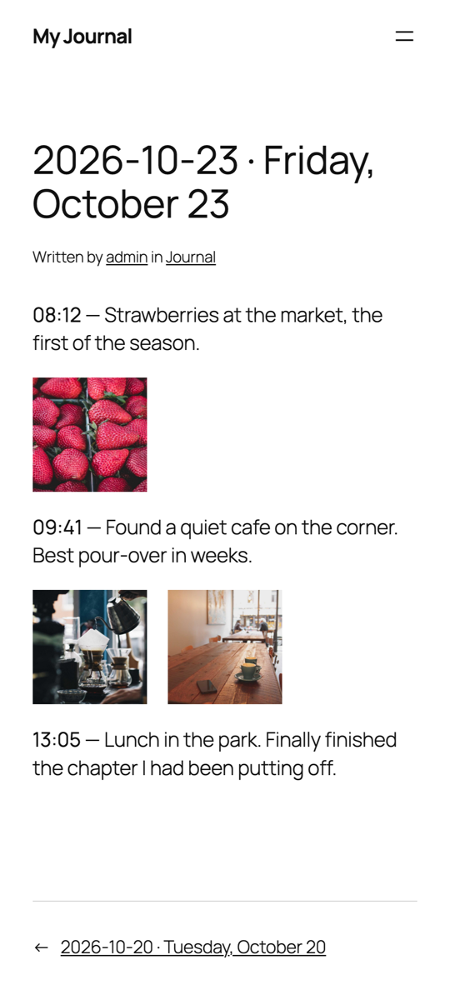

# Jot2Press

An Android app and a WordPress plugin: jot something down from a home-screen widget and
it goes in today's post on your blog.

> [!NOTE]
> This project is AI-assisted. I've been a software developer for almost a decade, but
> only on web-based systems and applications.

<p align="center">
  
  
  
</p>

## Why

I've been wanting to start journaling for some time now. Micro-blogging is perfect for
this, but the official WordPress and Jetpack apps have too much friction to get a post up.
I didn't want to navigate all the way to the editor, think of a title, then choose a
category. Usually, by the time I got there, I'd lost any motivation I had to write. On
the other hand, micro-blogging platforms like Twitter (X) are clearly not suited
for a journal. So I made Jot2Press: tap the widget, write, and you're done. The title is
generated, the category is chosen once, and the entry goes to your blog.

## How it works

- **Write:** a widget on the home screen opens a small dialog where you write the entry.
  An entry can have text, up to 10 photos and, optionally, the place where it was
  written.
- **Change your mind:** each entry waits on the phone for 60 seconds (configurable)
  before it's sent, so you can still edit or delete it. Entries written offline wait
  until there is a connection.
- **Read:** the WordPress plugin adds each entry, with its time, to a single post for the
  day. Posts are private and go to the "Journal" category by default; you can change
  both in the app.
- **Fix:** a badge appears on the widget only when something needs your attention, for
  example an entry that could not be sent or a sign-in your blog rejected.

## What's in the repository

| Path | What it is |
|---|---|
| [`android/`](android/README.md) | The Android app (Kotlin, Jetpack Compose), for Android 10 or later |
| [`plugin/`](plugin/README.md) | The WordPress plugin, for WordPress 7.1 or later, served over HTTPS |
| `project.json` | The names shown for the app and the plugin |

## Quick start

1. **Plugin:** download `jot2press.zip` from the
   [latest release](https://github.com/LeoAlfaroC/Jot2Press/releases/latest), then
   upload it in Plugins → Add New → Upload Plugin and activate it.
2. **Application password:** in WordPress, go to Users → Profile → Application
   Passwords, create one for the app and copy it.
3. **App:** download the APK from the same release and install it on your phone. Later
   releases install over it and keep your queue and settings.
4. **Connect:** open the app and enter the site URL, the username and the application
   password. Press `Test connection`, then `Save`.
5. **Widget:** long-press the home screen, open Widgets and add Jot2Press.

### Build from source

- **Plugin:** `cd plugin && npm run build` writes `jot2press.zip`.
- **App:** with a phone connected, `android/gradlew -p android :app:installDebug`
  installs a debug build. A debug build is for development: it is signed with your
  machine's debug key, so it can't be updated to a release (or a build from another
  machine) without uninstalling it, which deletes its queue and settings. To make your
  own release, see "Build a release" in the app's README.

The READMEs in `android/` and `plugin/` cover release builds, configuration, renaming,
upload limits and the API.

## Privacy

- Credentials are encrypted with the Android Keystore, and the app only talks to your
  blog, over HTTPS.
- Photos never leave the phone with the place where they were taken.
- Location is off until you turn it on, and then it's sent only for the entries you
  choose.
- Each README has the full list for its side.

## Development

```bash
android/gradlew -p android :app:testDebugUnitTest            # app
cd plugin && npm install && npm run env:start && npm test   # plugin (Docker)
```

Read [AGENTS.md](AGENTS.md) before you change code: it covers the workflow, the contract
between the app and the plugin, and the conventions.

## License

[GPL-2.0-or-later](LICENSE), the same license as WordPress. The fonts in the app are
under the SIL Open Font License 1.1; their licenses are in
`android/app/src/main/assets/licenses/`.
